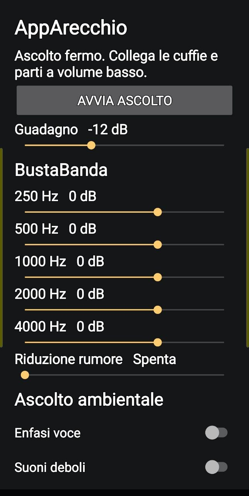
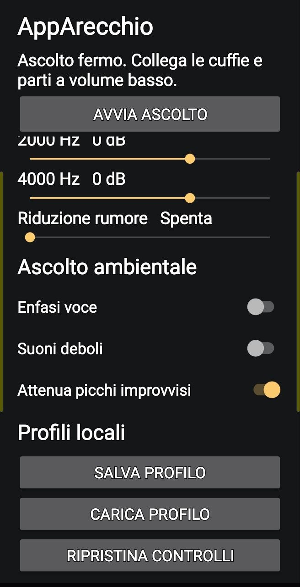

# AppArecchio Tattico J.1.12

AppArecchio è un’app Android di ShiduLab per regolare l’ascolto di voci e suoni nell’ambiente. Usa il microfono integrato del telefono e riproduce il segnale in mono nelle cuffie. L’elaborazione avviene sul dispositivo. L’app conserva i profili nella memoria privata, non salva registrazioni e non richiede accesso alla rete.

[Scarica APK J.1.12](downloads/AppArecchio-J.1.12.apk) · [Pagina di AppArecchio su ShiduLab](https://www.shidulab.org/SofficiWare-ShiduLab/AppArecchio-Tattico.html)

## BustaBanda e controlli

BustaBanda ha dieci bande parametriche, con guadagno, frequenza centrale e Q regolabili. Il modulo scorre in orizzontale anche con il telefono in verticale. Ciascuna banda si regola da meno 12 a più 6 dB. Il guadagno generale va da meno 24 a più 12 dB ed è indipendente dal volume multimediale di Android.

L’app offre tre livelli di riduzione del rumore, enfasi della voce, compressione per rendere più udibili i suoni deboli e attenuazione dei picchi improvvisi. I profili salvano localmente queste regolazioni. Un limitatore contiene i picchi digitali e la sessione si arresta quando la limitazione persiste.

## Samsung Galaxy A15 e requisiti Android

Il Samsung Galaxy A15 è il dispositivo di riferimento. Il manifesto dichiara Android 11 o successivo, API minima 30, e target API 35. Servono il microfono integrato e cuffie riconosciute da Android. L’app prevede l’uscita jack da 3,5 mm, dispositivi USB riconosciuti come cuffie e dispositivi Bluetooth esposti da Android come A2DP o LE Audio. Il percorso Bluetooth per le chiamate SCO è escluso.

Collega le cuffie, abbassa il volume multimediale e avvia l’ascolto dall’app aperta. Android richiede il permesso del microfono e può chiedere quello delle notifiche. Il servizio in primo piano consente di continuare l’ascolto mentre si usano altre app. L’app verifica il percorso audio e richiede l’arresto se cambia.

## Limiti tecnici

Il motore elabora PCM a 48 kHz in blocchi da 5 ms. La durata di un blocco descrive soltanto l’elaborazione interna. Il ritardo effettivo dipende da acquisizione, buffer, sistema e cuffie. Alla disconnessione possono restare campioni già accodati. La riduzione del rumore può attenuare le voci deboli e il controllo dei suoni deboli può alzare il rumore di fondo.

Il limitatore digitale non misura la pressione sonora all’orecchio. AppArecchio è un’app assistenziale privo di calibrazione clinica. Non va usato come protezione dell’udito. Per le prime prove usa un volume basso.

## Sorgenti e compilazione

I sorgenti Java si trovano in `src`, le risorse Android in `res`. Per compilare su Windows servono PowerShell, JDK 21, Android SDK Platform 35 e Build Tools 35.0.0.

```powershell
.\Build.ps1 -Sdk 'C:\percorso\Android\Sdk' -Destination .\pacchetto
```

Lo script compila il progetto e genera un APK firmato con una chiave locale. Per aggiornare una build già installata occorre la stessa chiave. Conserva la chiave generata fuori dal controllo versione.

## Schermate





## Novità della J.1.12

Dieci bande con scorrimento a dito, profili precedenti compatibili e icona Pluto su fondo nero.

## Novità della J.1.4

BustaBanda ha cinque cursori verticali. A fondo corsa il filtro sopprime la frequenza indicata. Azzera bande riporta i cursori a 0 dB. Il Botologo apre ShiduLab e il cuore apre PayPal. Icona della Home con sfondo antracite.
